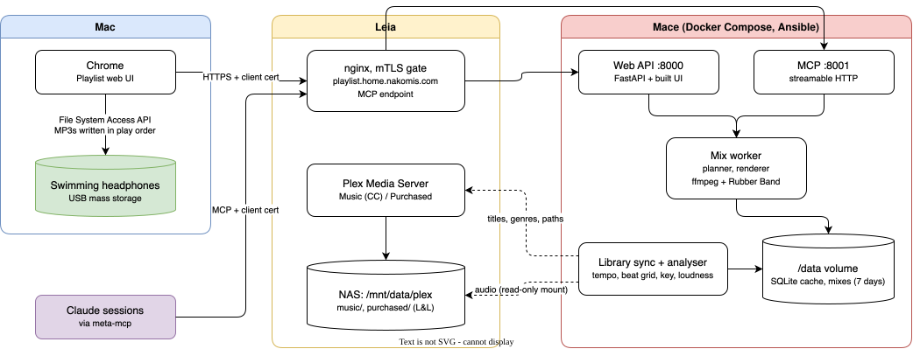

# Playlist — beat-matched continuous mixes from Plex, written straight to swimming headphones

## Support

If you find this useful, please consider buying me a coffee:

[](https://www.paypal.com/donate?hosted_button_id=Q3BESC73EWVNN&custom=playlist)

## Table of Contents

<!-- toc -->

- [What it does](#what-it-does)
- [Architecture Diagram](#architecture-diagram)
- [Repository Layout](#repository-layout)
- [Headphone test kit](#headphone-test-kit)
- [Architecture Diagrams](#architecture-diagrams)
- [Support](#support)

<!-- tocstop -->

## What it does

Pick a genre, a duration and which Plex libraries to draw from. Playlist
analyses the tracks (tempo, beat grid, key, loudness), plans an order that
flows harmonically and in tempo, and renders a continuous DJ-style mix:
time-stretched, bar-aligned transitions with the bass swapped across each one.

The mix comes out as roughly five-minute MP3s cut at bar starts, or as one
long file, and the browser can write them straight onto a mounted MP3 player
such as a pair of bone-conduction swimming headphones, in play order.

- **Libraries:** *Music* (Creative Commons, from the Free Music Archive) and
  *Purchased* (bought music). A mix is marked publishable only if every track
  is CC, and it carries the attribution the CC BY tracks need.
- **MCP:** the same operations are exposed to Claude sessions over MCP.
- **Runs on** Mace, at `playlist.home.nakomis.com`, behind Leia's mTLS gate.

Project tracker: Plane `PLAY`. Origin: Lapcat's LAPC-13.

## Architecture Diagram



## Repository Layout

| Path | Contents |
|---|---|
| `backend/` | Python service: library analyser, mix planner, renderer, API, MCP server |
| `web/` | React + Vite + Tailwind front end (pnpm) |
| `tools/headphone-test/` | Gap, play-order and resume tests for the headphones (PLAY-1) |
| `docs/` | Logo, architecture diagram |

## Headphone test kit

Cheap MP3 players differ in whether they play files gaplessly, which order
they play them in, and whether they resume a long file after power-off. The
kit answers all three:

```bash
tools/headphone-test/make-kit.sh                        # builds out/{gap,order,resume}
tools/headphone-test/load-kit.sh order /Volumes/<NAME>  # one test at a time
```

`load-kit.sh` writes the files one by one in a known order (no `._` files) and
ejects. The **order** test speaks five words: *Charlie Echo Alpha Delta Bravo*
means the player sorts by filename, *Alpha … Echo* by ID3 track number, and
*Delta Bravo Echo Charlie Alpha* by copy order.

## Architecture Diagrams

`docs/architecture/playlist.drawio` is the source for the diagram above.
The SVG is auto-regenerated on commit by the pre-commit hook in `.githooks/pre-commit`.

To activate the hook after cloning:

```bash
git config core.hooksPath .githooks
```

## Support

If you find this useful, please consider buying me a coffee:

[](https://www.paypal.com/donate?hosted_button_id=Q3BESC73EWVNN&custom=playlist)
